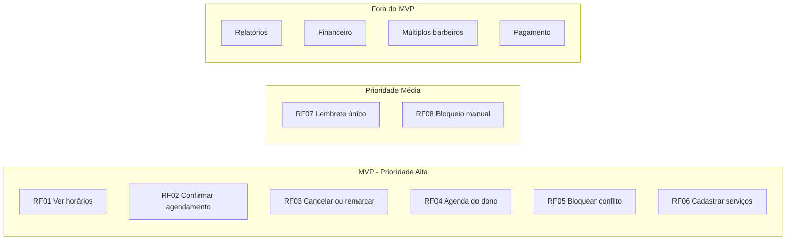

# Backlog — Sistema de Agendamento para Barbearia

Backlog consolidado e especificações estruturadas dos itens priorizados, rastreáveis ao TP1 e ao TP2.

## Estrutura

```text
backlog/
├── README.md
├── consolidado.md
├── especificacoes/
│   ├── RF01-ver-horarios.md
│   ├── RF02-confirmar-agendamento.md
│   ├── RF03-cancelar-remarcar.md
│   ├── RF04-agenda-do-dono.md
│   ├── RF05-bloquear-conflito.md
│   ├── RF06-cadastrar-servicos.md
│   ├── RF07-lembrete.md
│   └── RF08-bloquear-horario-manual.md
└── aprendizados.md
```

## Resumo do backlog



## Como navegar

- `consolidado.md` — visão geral do backlog priorizado com rastreabilidade.
- `especificacoes/` — um arquivo por requisito, com objetivo, critérios de aceitação, rastreabilidade e restrição técnica.
- `aprendizados.md` — síntese dos aprendizados de validação que moldaram o backlog.

## Decisões técnicas que afetam o backlog

- Backend em .NET ASP.NET Core, repositório próprio.
- Frontend mobile em Flutter, repositório próprio.
- Frontend web em Angular, repositório próprio.
- Hospedagem em ambiente único com serviço de secret.
- Identidade visual básica restrita ao serviço do barbeiro.
- Cliente sem login, identificado por telefone.

## Regras de priorização

- Valor direto para o barbeiro e para o cliente.
- Dependência técnica entre itens.
- Risco de bloquear outros itens se não for feito cedo.
- Simplicidade e custo baixo como restrição permanente.
