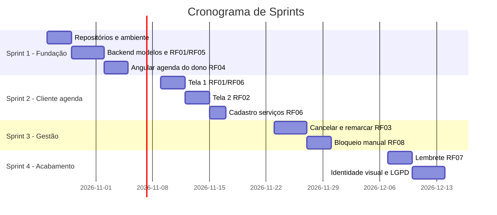

# Sprints — Plano de Construção

Cronograma inicial de sprints com critérios de priorização explícitos.

## Estrutura

```text
sprints/
├── README.md
├── criterios.md
├── sprint-01.md
├── sprint-02.md
├── sprint-03.md
└── sprint-04.md
```

## Visão geral



## Critérios de priorização

- Valor direto para o barbeiro e para o cliente.
- Dependência técnica entre itens.
- Risco de bloquear outros itens se não for feito cedo.
- Simplicidade e custo baixo como restrição permanente.

## Regras de alocação

- Nenhuma sprint começa sem que os itens da sprint anterior estejam concluídos ou explicitamente replanejados.
- Requisitos não funcionais entram como critério transversal, não como item isolado.
- Itens fora do MVP não entram no cronograma.
